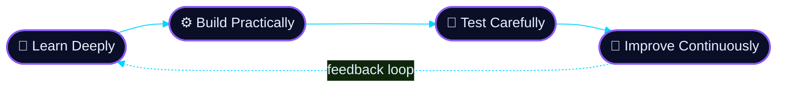

<div align="center">

<!-- ░░░ ANIMATED NEURAL-CORE BANNER (assets/banner.svg) ░░░ -->


<br/>


<br/><br/>

<a href="https://www.linkedin.com/in/sadashiv-gawade-b658732a9/"></a>
<a href="https://github.com/SadashivGawade321"></a>
<a href="https://github.com/SadashivGawade321?tab=repositories"></a>


</div>


## `> system.boot --verbose`

```ansi
[  OK  ] Initialising neural core ......................... done
[  OK  ] Loading language runtimes: Python · JS · TS · C++ . done
[  OK  ] Mounting AI/ML · NLP · Generative AI stack ....... done
[  OK  ] Starting full-stack services ..................... done
[ WARN ] Curiosity level: UNSAFE — continuous learning active
[  OK  ] System ready. Awaiting the next engineering challenge ▌
```


## `> cat engineer.config.json`

```json
{
  "name": "Sadashiv Gawade",
  "role": "B.Tech Information Technology Undergraduate",
  "specialisation": ["AI / Machine Learning", "Natural Language Processing", "Generative AI", "Full-Stack Development"],
  "core_languages": ["Python", "JavaScript", "TypeScript", "C++"],
  "currently_strengthening": ["System Design", "Data Structures & Algorithms", "CI/CD with GitHub Actions"],
  "engineering_principle": "Learn deeply. Build practically. Test carefully. Improve continuously.",
  "seeking": ["Internships", "Entry-Level Roles", "Open-Source Collaboration"],
  "status": "online"
}
```

### `> engineering.pipeline`




## `> model.summary()` · Technology Stack

<div align="center">

<table>
<tr>
<td align="center" width="22%"><b>🔹 INPUT LAYER</b><br/><sub>Languages</sub></td>
<td align="center"></td>
</tr>
<tr>
<td align="center"><b>🟣 HIDDEN LAYERS</b><br/><sub>AI · ML · Data Science</sub></td>
<td align="center">

<br/>


</td>
</tr>
<tr>
<td align="center"><b>🔴 OUTPUT LAYER</b><br/><sub>Full-Stack Delivery</sub></td>
<td align="center"></td>
</tr>
<tr>
<td align="center"><b>🛡️ INFRASTRUCTURE</b><br/><sub>Databases · DevOps · Tooling</sub></td>
<td align="center"></td>
</tr>
</table>

</div>


## `> ls ./featured-projects`

<table>
<tr>
<td width="50%" valign="top">

### 🔎 CodeAtlas AI


AI-assisted codebase exploration platform for understanding architecture, dependency relationships, and the potential impact of code changes.

**Stack:** `React` `Node.js` `Express` `MongoDB` `GitHub API`

<a href="https://codeatlas181.netlify.app/">

</a>

</td>
<td width="50%" valign="top">

### 🤝 SAATHI ONE


Multilingual AI receptionist demo that handles service enquiries, business information, and booking workflows.

**Stack:** `Python` `Streamlit` `AI Workflows`

<a href="https://saathi-sadashiv.streamlit.app/">

</a>

</td>
</tr>
<tr>
<td width="50%" valign="top">

### 🧑‍💼 AIHire OS


Interview platform concept featuring candidate interview experiences alongside HR and admin management workflows.

**Focus:** `Full-Stack` `Interview Workflows`

<a href="https://github.com/SadashivGawade321/AIHIRE">

</a>

</td>
<td width="50%" valign="top">

### ⚡ Distributed Rate Limiter Simulator


Browser-based simulator for exploring rate-limiting algorithms, caching strategies, traffic management, and distributed-systems concepts.

**Focus:** `Algorithms` `System Design` `Distributed Systems`

<a href="https://distrubuter-ratelimiter.netlify.app/">

</a>

</td>
</tr>
</table>

<div align="center">
<a href="https://github.com/SadashivGawade321?tab=repositories">

</a>
</div>


## `> ./run --analytics`

<div align="center">


<br/>


<br/><br/>

**`[ ACTIVITY GRAPH ]`**


**`[ CONTRIBUTION MATRIX ]`**


**`[ ACHIEVEMENTS ]`**


</div>

<!--
  OPTIONAL: Contribution "snake" animation.
  1. Add .github/workflows/snake.yml using the Platane/snk action (outputs to an "output" branch).
  2. Then uncomment the block below.

<div align="center">
<picture>
  <source media="(prefers-color-scheme: dark)" srcset="https://raw.githubusercontent.com/SadashivGawade321/SadashivGawade321/output/github-contribution-grid-snake-dark.svg"/>
  
</picture>
</div>
-->


## `> tail -f ./current-objectives.log`

<table>
<tr>
<td width="33%" valign="top" align="center">

### 🧠 AI & MACHINE LEARNING
Building practical AI applications, advancing NLP skills, and practising rigorous model evaluation.

</td>
<td width="33%" valign="top" align="center">

### 🌐 SOFTWARE ENGINEERING
Designing robust APIs, scalable full-stack applications, and maintainable, well-tested code.

</td>
<td width="33%" valign="top" align="center">

### ⚙️ SYSTEMS & CI/CD
Mastering DSA and system design while automating testing and delivery with GitHub Actions.

</td>
</tr>
</table>


## `> ./connect --open`

I am interested in AI-powered products, developer tooling, and open-source collaboration.

**Open to internships and entry-level roles in:**
`AI / ML` · `Python Development` · `Data Science` · `Full-Stack Development`

```bash
sadashiv@neural-core:~$ echo "Let's build something remarkable together."
> Let's build something remarkable together.
```

<div align="center">

<a href="https://www.linkedin.com/in/sadashiv-gawade-b658732a9/">

</a>
<a href="https://github.com/SadashivGawade321">

</a>

<br/><br/>


</div>
